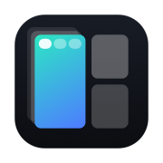
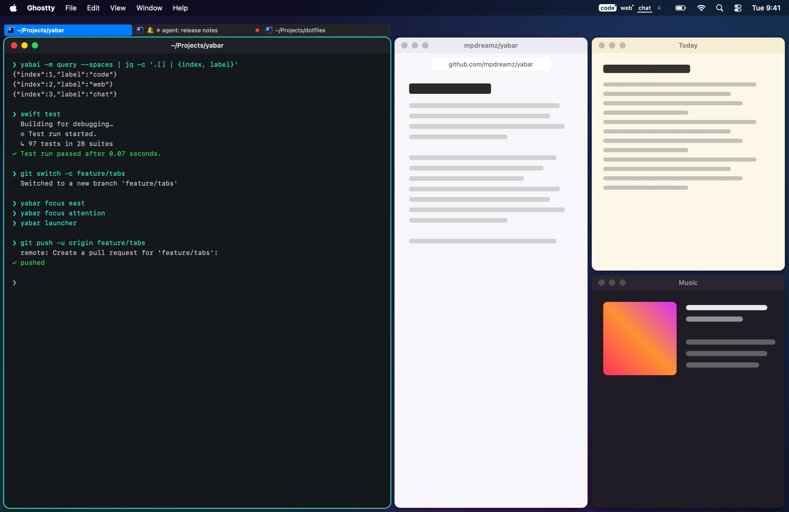
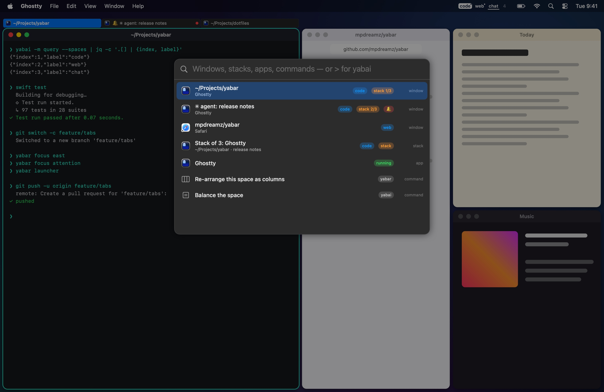

<p align="center">
  
</p>

<h1 align="center">Yabar</h1>

<p align="center"><b>Spaces, stacks and tabs for <a href="https://github.com/asmvik/yabai">yabai</a>, in the menu bar.</b></p>

<p align="center">
  <a href="https://github.com/mpdreamz/yabar/releases/latest"></a>
  
  
  <a href="LICENSE"></a>
</p>

<p align="center">
  <a href="https://mpdreamz.github.io/yabar/"><b>Website & docs</b></a> ·
  <a href="https://github.com/mpdreamz/yabar/releases/latest/download/Yabar-arm64.zip">Download</a> ·
  <a href="https://mpdreamz.github.io/yabar/reference/cli/">The yabar command</a>
</p>



## What it does

- **Spaces in the menu bar**: focused, on another display, occupied or empty, with a dot for a stack and a bar for a
  window that wants you. Labels that survive yabai restarts. Click to go there.
- **Stack indicators**: app icons, slim pills or **i3-style tabs** beside every stack, never over a window. Yabar asks
  yabai for just enough room and gives it back. Click to focus, middle-click to close.
- **One set of keys through stacks and tiles**: `yabar focus west|east|north|south` steps through a stack's windows,
  then on to the next tile and display, the way i3 does.
- **A launcher**: every window on every space, stacks, scratchpads, apps, and Yabar's and yabai's commands.
- **Attention**: a 🔔 from Ghostty or a `(3)` in a title badges the window and its space; `yabar focus attention` goes there.
- **Layouts per display or space**: columns instead of yabai's spiral, focus sizing (the golden share for the focused
  window), auto-stack, padding, gap and layout.
- **Scratchpads**: yabai's own, set up in Yabar, on one key.
- **Well behaved**: no Accessibility or Screen Recording permission, everything labelled `yabar-` and put back when it
  quits, one instance at a time, signed, notarized, and it updates itself.

| Stacks as tabs, icons or pills | The launcher |
|---|---|
|  |  |
| **Four columns instead of the spiral** | **Focus sizing, golden ratio** |
|  |  |

## Install

```sh
brew install --cask mpdreamz/tap/yabar
```

or `curl -fsSL https://raw.githubusercontent.com/mpdreamz/yabar/main/install.sh | sh`. Apple Silicon, macOS 15+, and
yabai running. yabai's scripting addition is optional (clicking an empty space, scratchpads).

Then bind it in skhd:

```sh
lcmd - h : yabar focus west
lcmd - j : yabar focus south
lcmd - k : yabar focus north
lcmd - l : yabar focus east
lcmd + shift - space : yabar launcher
lcmd - 0 : yabar focus attention
```

Everything else is in the **[docs](https://mpdreamz.github.io/yabar/)**.

## Build

```sh
mise run dev     # debug build, then open build/Yabar.app
mise run test
mise run shots   # redraw every image in docs/images, and the app icon
mise run docs    # build the docs and landing page as CI does, served on :4000
```

MIT licensed.
