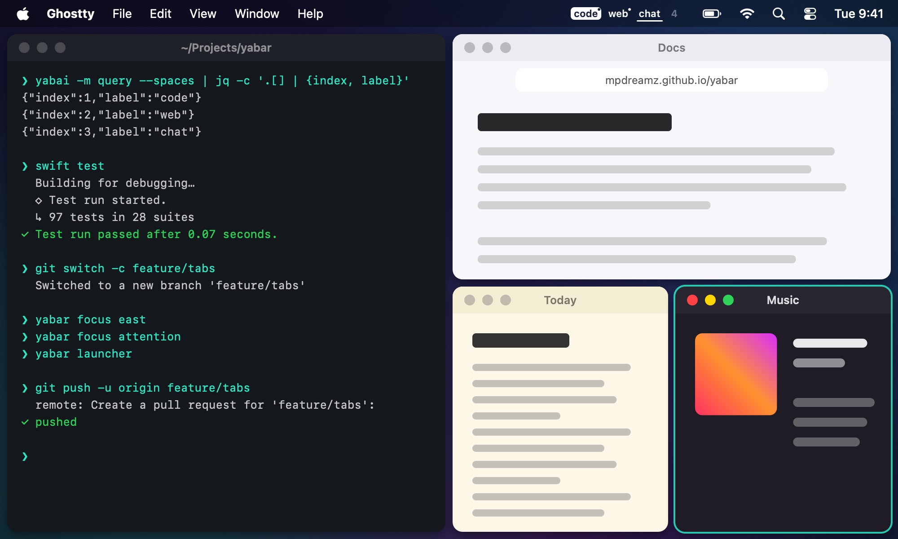
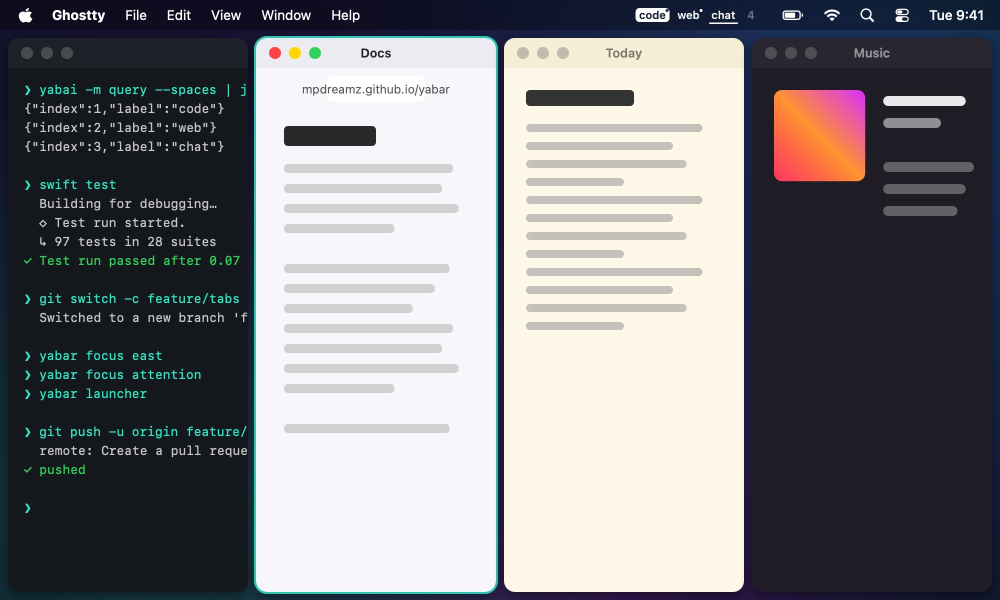

# Columns

With its default `split_type auto`, yabai splits the focused window along its longer side, so windows spiral. A
profile's **Columns** lines them up side by side instead:

| yabai's spiral | Four columns |
|---|---|
|  |  |

- New windows split the focused one sideways (`split_type vertical` for the space), and yabai keeps the columns equal
  (`auto_balance`), unless [focus sizing](focus-sizing.md) sizes them.
- **Beyond the columns**, a new window becomes a **row** under the focused tile (the default), or joins its **stack**.
- **Re-arrange this space as columns** in the [launcher](../moving-around/launcher.md) lays out the windows already
  there: the first tiles as columns in their order, the rest as rows; stacks move whole.

Apps with a minimum size keep it: a window that won't get narrower than its column overlaps its neighbour.
