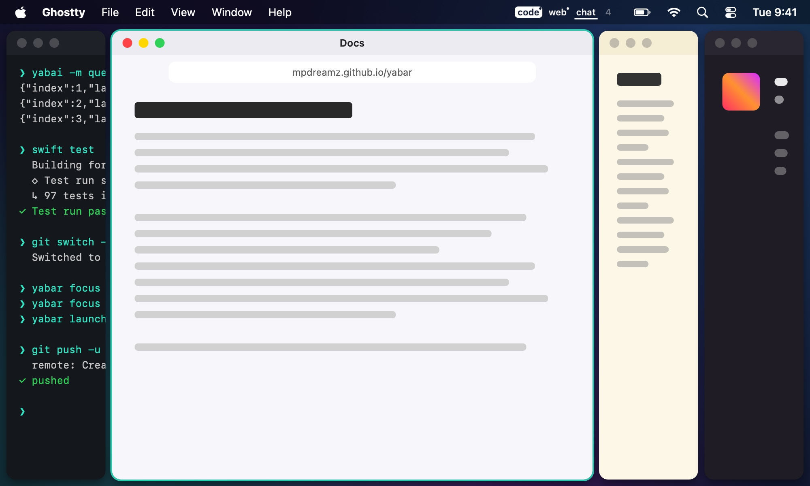

# Focus sizing

A profile's **Focus sizing** gives the focused tile's column a share of the width, and the tile that share of its
column's height; the other columns and rows share the rest equally.

- **Golden ratio** (0.62, the default when on), **Half** (0.5) or **Two thirds** (0.67). **Off** turns it off where a
  broader profile has it on.
- It follows focus from tile to tile, a moment after focus settles. Moving within a stack doesn't count.
- A line you drag yourself stays until focus moves to another tile.
- It works with any layout yabai makes, not only columns: Yabar reads the layout from the windows and moves each line
  between them with yabai's resize.

An app holding a minimum size bigger than its share overlaps its neighbour; focus sizing then leaves that space as it is.
