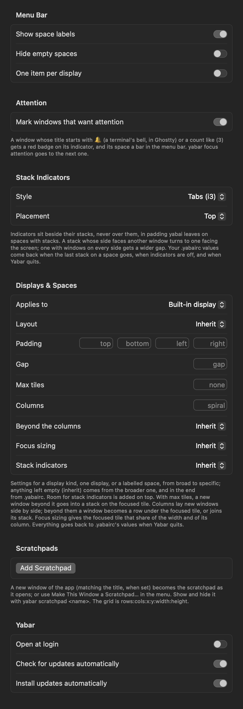

# Settings

Settings… (⌘,) in the menu. Choices apply as they are made.

| Section | Setting | Default | |
|---|---|---|---|
| Menu Bar | Show space labels | on | A label instead of the number. |
| | Hide empty spaces | off | Spaces on screen always show. |
| | One item per display | off | An item per display instead of one. |
| Attention | Mark windows that want attention | on | [Attention](../stacks/attention.md). |
| Stack Indicators | Style | Icons | Icons, Pills, Tabs (i3), Off. |
| | Placement | Screen edge side | Or Left, Right, Top, Bottom. |
| Displays & Spaces | … | inherit | [Profiles](../layouts/profiles.md). |
| Scratchpads | … | none | [Scratchpads](../moving-around/scratchpads.md); needs the scripting addition. |
| Yabar | Open at login | on from the first launch | |
| | Check for updates automatically | on | |
| | Install updates automatically | on | |
