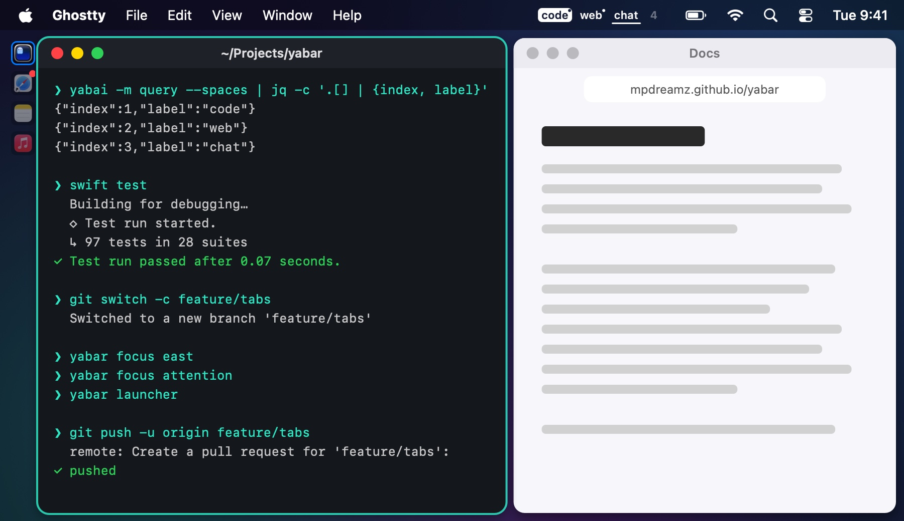
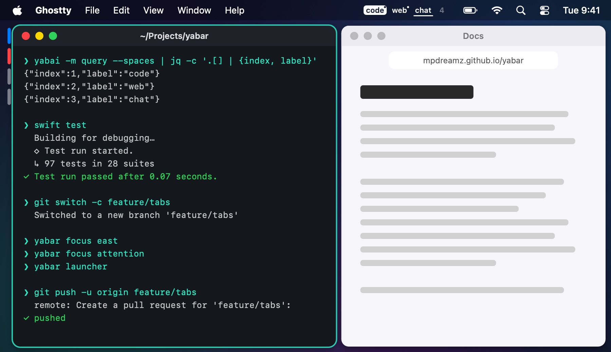
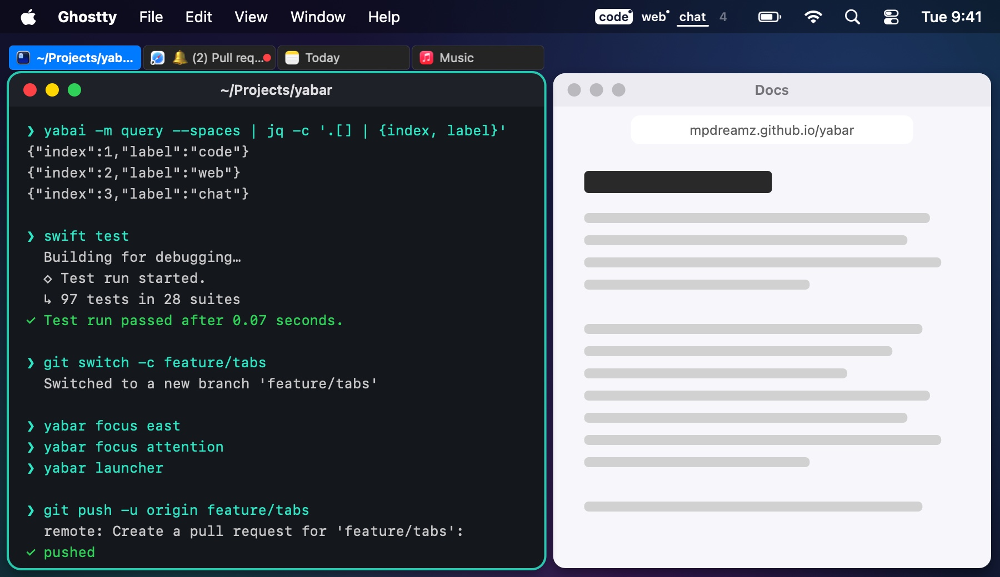

# Indicators

One indicator per window of a stack, in stack order, beside the stack. The window on top is marked in the accent colour
while its stack has focus; the others are dimmed, more so when focus is elsewhere.

| Style | |
|---|---|
| **Icons**: the app's icon on a tile. |  |
| **Pills**: a slim pill per window. |  |
| **Tabs (i3)**: a tab per window with its icon and title, across the top or bottom. |  |

- **Click** an indicator to focus its window.
- **Middle-click** one to close its window.
- Hover for the app and title.

## Placement

Settings → Stacks → **Placement**:

- **Screen edge side** (the default): the side where the stack meets the screen, read from its neighbours; for a stack
  as wide as the screen, left; for one with windows on both sides, the nearer half of its display.
- **Left**, **Right**, **Top** or **Bottom**.

Tabs only run along the top or the bottom. Whatever you choose, a side that faces another window gives way to one that
faces the screen ([Room](room.md)). Each display or labelled space can have its own style ([Profiles](../layouts/profiles.md)).
